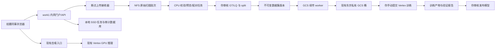

# X 光同事内网上传、去噪与训练数据管理方案

日期：2026-11-18（JST）

状态：原始设计稿。2026-11-19 已实现 TIFF/ZIP 接收、配对审核、数据冻结及 GCS 同步，见 [当前操作说明](xray-portal-operations-20261119.md)。本文的 RAW 转换、训练操作页、模型发布及批量推理仍为后续设计。

## 1. 建议采用的使用方式

给拍摄同事一个固定的公司内网入口，首页保留两个清楚的动作：

- **Denoise images**：上传要处理的图片，选择已有可用模型，等待结果并下载。适合日常使用。
- **Submit scans**：上传一批原始扫描、填写拍摄条件，交给你审核是否适合用于训练。适合新增工件、参数或模型改进需求。

同事只需要浏览器和公司内网连接，不需要安装 gcloud、不需要 Google Cloud 账号，也不用先传 Google Drive 再转给你。**上传完成不会自动启动训练，也不会自动替换正在服务的模型。** 你在审核界面确认配对和数据划分后，再明确提交训练。

用户已确认日常数据基本为 TIFF，GT 也由拍摄同事上传；历史还存在 RAW 压缩文件。第一期以 TIFF 接收与审核为主，RAW 先保留原件并识别数据类型，转换能力按样本和元信息另行验收。单页/多页 TIFF、实际文件大小和单批体量尚未确认。

第一期建议走“浏览器 → work1 → NFS 原始数据 → 后台上传 GCS”。公司网络传大文件较方便，拍摄电脑无需直接连接 Google API；即使外网暂时不通，已经收妥的原始数据也能留在公司内网。云端训练仍从现有东京私有 GCS 桶读取已审核的数据版本。

## 2. 当前已经具备什么

以下是对现有代码的核对结果，不代表下面的新门户已经实现。

| 项目 | 当前实现 | 新方案如何复用 |
|---|---|---|
| 内网推理页面 | work1 `http://192.168.3.11:7861`，英文 Gradio，CPU 前端调用 Vertex | 保留去噪入口，后续接到统一导航 |
| 模型 | 页面列出 11 项，当前只有 Cylinderhead final 部署到 Vertex | 仅允许使用已部署、已验收模型；训练完成后由你审核发布 |
| 上传推理 | 单张图片；代码对包含 base64 的请求实施 10 MB 检查 | 第一阶段继续服务单图，不把几十 GB 的训练归档送进此调用 |
| GCS 推理协议 | 服务代码支持可选 `input_uri/output_uri` | 先核实预测运行身份的对象权限、做专项验收后，才用于大图/批处理 |
| 原始数据 | `/mnt/data` 为真实 NFS；源码位于共享 `/mnt/home` | 原始扫描与训练产物放数据区；不放 Git 工作区 |
| 训练数据准备 | 有 GT/LQ 配对、split 检查、归档 SHA256、GCS 上传及训练入口 | 上传系统负责接收和审核，导出兼容的训练归档 |
| 当前上传脚本 | 管理员使用本机用户 ADC，支持 GCS 续传、防覆盖 | 可作为后台 worker 的初期执行入口，不暴露凭据给浏览器 |

主要代码依据：[现有页面](../../deploy/vertex/internal_ui.py)、[Vertex 服务](../../deploy/vertex/serve.py)、[训练数据预检](../../deploy/vertex/training/prepare_data.py)、[管理员上传工具](../../deploy/vertex/training/upload-data.sh)、[历史配对与训练流程](../../scripts/workflows/cylinderhead_20261104/README.md)。

## 3. 同事实际看到的流程

### 日常去噪

1. 打开内网页面，选择 `Denoise images`。
2. 选择图片或一个批次，选择已发布模型；显示文件数量、预计输入大小。
3. 点击 `Start denoising`，得到任务编号。页面可以关掉，之后从 `My jobs` 回来查看。
4. 结果页显示输入/输出比较、采用的模型版本、完成数量和失败文件；可单张下载或下载一个结果包。
5. 需要反馈时填写 `Image quality feedback`，反馈关联任务与原图。不能把模型输出默认当作新的 GT。

现有页面只实现了单图同步流程。第一期接收门户不承诺同时改造所有批处理推理；可以在导航中保留当前入口，之后再增加持久化推理任务。

### 提交新扫描用于模型改进

1. 点击 `Submit scans`，填写“工件/批次”和“拍摄条件”。
2. 在 `Noisy images` 与 `Reference images (GT)` 两个区域分别上传 TIFF 或包含 TIFF 的归档，并关联同一工件、扫描与切片标识。GT 由同事提供，进入系统时仍需配对和质量审核。历史 RAW 归档放到独立的 `RAW files — pending conversion` 区域，保留原件后等待格式识别。
3. 页面显示已收字节、剩余量、失败文件及 `Pause / Resume`。网络断开后重新打开页面可继续，必要时重新选择原文件。
4. 完成后显示 `Received on company storage`；后台检查格式、完整性、元信息，再显示 `Awaiting review`。
5. 同事可以看到你需要补充什么、是否已接收为某个数据集，以及最终反馈结果；不能直接选择 GPU 数量、修改 split 或点击正式训练。

界面必须区分 `Received on company storage` 与 `Copied to cloud storage`。本地接收完成时不能显示“云端上传完成”；只是有图片，也不能显示“可训练”。

## 4. 第一阶段系统结构



部署仍放在 work1，全部入口仅监听实际内网地址；不需要公网网页、域名、公网对象或 Cloud Run。代码统一在 BasicSR 仓库维护，例如将来新增 `apps/xray_portal/`、`deploy/internal/`；不要再建立按时间命名、彼此重复的本地项目。

建议组件：一个内网反向代理、一个轻量 API/页面进程、一个支持 tus 的上传接收器、一个 CPU 后台 worker。第一期并发量小，可用 work1 本地 SSD 上的 SQLite 保存状态，由单实例 API/worker 串行协调写入；数据库、上传锁和 GCS 续传状态不放 NFS。数据文件和校验清单放 NFS。需要多台主机或更多 worker 时，再迁移到集中式数据库与队列，不必一开始引入完整集群。

进程重启后应从数据库恢复未完成任务；不要仅依赖 Gradio 内存队列。worker 以持久化任务 ID 和租约领取工作，完成动作幂等；重试不能重复创建同一训练或覆盖同一对象。服务端负责组装文件路径及 GCS 对象名，浏览器不能传任意服务器路径或任意 GCS URI。

## 5. 大文件与断点续传

浏览器至 work1 建议使用成熟的 tus 协议实现，开始时采用 16–64 MiB 分块、每浏览器同时传 2 个文件作为待实测默认值；具体值根据内网带宽、NFS 写入速度和同事实际文件调整。协议用查询已收偏移与后续分块继续传输，避免自行设计不兼容的分块重试规则。依据：[tus 协议](https://tus.io/protocols/resumable-upload)。

上传开始前，后端检查实际 NFS mount、可写性、剩余空间、该批次的大小限额及可接受文件数。NFS 未挂载时明确拒绝，不能创建同名本地目录。每份文件使用系统生成的 ID 和 `.partial` 状态；原始文件名作为元数据保留。上传数据按流写入，不整份读入内存，也不经过 Gradio 的整包临时缓存。

服务端逐文件验证大小、计算 SHA256；完成后在同一 NFS 文件系统内转为完整文件，并提交清单。只有清单提交成功，批次才进入 `Received`。重启时通过清单与数据库对账；不能只凭浏览器的“上传完成”回调确认文件。浏览器重选文件恢复时，要核对大小、文件指纹以及已有分块，不能把同名但已变更的源文件接到旧任务上。

归档先列出内容再解包：限制展开大小、文件数、最大单图像素、最大页数和 CPU 时间，拒绝绝对路径、路径逃逸、设备文件及不允许的链接；保持原归档不变。首期按 TIFF 设计，但实际单页/多页、位深、压缩方式和大小仍需样本确认。文件接收时识别页数与类型，已支持路径才进入预览或训练转换；不支持的类型显示待适配，不能静默取第一页、按 8 位转换或把接收成功等同于已支持推理。

服务器至 GCS 使用官方工具或 SDK 的 resumable upload；网络失败后读取已持久化的上传状态继续。GCS 续传 session URI 具有授权作用，因此只在 work1 私有状态目录保存，不放页面、日志或 NFS 交接文件。依据：[GCS 续传](https://docs.cloud.google.com/storage/docs/resumable-uploads)。

对象名使用 `batch_id/file_id` 或数据集版本号，写入时使用 generation-match 0。完成后核对对象大小、GCS 完整性校验值以及清单中的 SHA256，记录对象 generation。SHA256 写进 metadata 本身不能替代传输校验。generation 0 可以拒绝覆盖已经存在的同名对象；依据：[GCS 请求前置条件](https://docs.cloud.google.com/storage/docs/request-preconditions)。

### RAW 压缩文件的两种处理路径

RAW 只是容器或文件命名线索，不能仅凭扩展名判断里面是体数据还是原始投影。先保存压缩原件、原有 sidecar/header/设备参数和校验值，再列出内容并识别：

| RAW 实际内容 | 首期处理 | 后续可以增加的转换 |
|---|---|---|
| **已重建体数据**，即三维体素阵列 | 保存原件；要求确认 `shape`、`dtype`、字节序 `endian`、轴含义/顺序、体素间距 `spacing`，并核对 header/字节偏移、存储顺序及压缩方式 | 格式明确后可程序化读取，按指定轴和切片编号导出 TIFF；先用已知断面核对方向、尺寸和数值 |
| **重建前的原始投影**，即不同角度的采集图 | 保存并标为 `Awaiting reconstruction`；收集设备格式与几何说明，不直接作为当前二维切片训练输入 | 需要重建流程、投影角度、探测器与旋转/源几何、像素单位及必要校正；可能需要厂商软件或其正式导出能力 |
| 无法识别或参数缺失 | 保存并标为 `Needs RAW metadata` | 取得代表文件、说明或已知正确导出结果后再适配 |

已重建体数据的正交切片/重切片，与重新执行 CT 重建是不同操作。如果同事需要“侧面投影”，先确认是侧向断面，还是最大值/积分等体数据投影；后者作为明确标记的派生结果，不能称为设备原始投影或自动作为 GT。切片和投影输出都记录源文件 SHA256、轴、间距、索引/范围和处理方法，不改变原件。

`shape/dtype/endian/offset/order` 等参数明确的二进制阵列可以用标准数值工具读取或内存映射，但这不能证明任意厂商 RAW 都能直接打开；参考 [NumPy 二进制 I/O](https://numpy.org/doc/stable/user/how-to-io.html) 和 [memmap 参数](https://numpy.org/doc/stable/reference/generated/numpy.memmap.html)。投影数据与体数据及其几何定义不同，重建必须有对应的几何信息；参考 [ASTRA 数据与几何概念](https://astra-toolbox.com/docs/concepts.html)。本方案不承诺 RAW 转换无需厂商软件。

## 6. 最少需要的拍摄信息

不让同事填写模型参数。界面先提供他们熟悉的拍摄字段，并支持从已有 `data.tsv`/CSV 导入，人工只补缺项。必填值不足时允许保存草稿，不能进入已审核数据集。

| 信息 | 建议字段 | 用途 |
|---|---|---|
| 工件与批次 | 工件类别、匿名内部工件 ID、拍摄批次 ID、操作者、日期 | 追踪来源、分组隔离，避免不同工件误配 |
| 扫描身份 | 扫描序列 ID、重复扫描编号、原始文件名、切片编号/方向 | 同位置 GT/LQ 配对，重复扫描不混组 |
| 设备与几何 | 设备 ID、重建版本/条件、像素或体素间距、图像尺寸 | 判断域差异与是否对齐 |
| 拍摄条件 | kV、µA 或 mA（保留单位）、曝光/帧数、binning、投影数 | 保留真实采集条件，不从文件夹名猜测 |
| 数据角色 | `Noisy images`、`Reference images (GT)`、`RAW files — pending conversion` | 同事分别提交噪声图与 GT；RAW 先识别，GT/LQ 关系由你审核 |
| 目的 | 仅去噪、提交数据改进模型、仅评估 | 避免评估集被自动纳入训练 |

首期按模板保存 `capture.json`/CSV；无需第一次就支持所有设备。未知字段保留 `unknown`，不能用 0 补齐。归档内已有采集元信息和新填写字段冲突时显示冲突，并保留两个来源。

## 7. GT/LQ 审核与数据版本

GT 已确定由同事上传。自动检查只负责提出候选配对：按工件 ID、扫描序列/位置、切片 ID、轴向与图像尺寸关联 `Noisy images` 和 `Reference images (GT)`，再检查两组是否空间对齐。相同文件名只是一项线索，不能据此认定 GT 或判定配对正确；“最大电流”“最清晰”也不能代替审核。几何变化、曝光饱和、运动、重建参数和重复扫描配准都可能影响监督目标。

审核页至少显示：候选 GT/LQ 对照、两图尺寸/数据类型、灰度范围与饱和比例、缺失切片、重复文件、几何偏移诊断和拍摄条件。历史 mean3 流程仅适用于经确认同一位置的重复扫描；平均、配准或裁剪都生成派生文件，并记录源文件 SHA256、算法版本和参数，不改原始图。

每次冻结一个数据集版本，包括：

- 原始批次及文件 SHA256、GCS generation；审核人和时间。
- GT/LQ 映射、派生处理记录、灰度归一化约定。
- train/monitor/test 清单、分组键、划分规则、种子和隔离带。
- 数据验证报告、训练归档及 SHA256；后续修订生成新版本。

同一工件/扫描序列、同一断面的不同电流条件及重复扫描必须保留在同一 split。新数据优先按独立工件/扫描组划分；当只有一个 CT 体时按连续切片区间及适当隔离带处理，并明确局限。不能把相邻切片随机打散后声称独立测试。已有 Cylinderhead split 保持原清单，不能因为增加数据重新随机拆分旧测试集。

仅检查文件名不重叠不够：还需要检查同内容 SHA256、同来源扫描组及派生来源的跨 split 重叠。输入给当前训练工具的是审核后导出的平面 `GT/`、`LQ/`、`train.txt`、`val_monitor.txt`、`normalization.json` 归档；外部文件夹结构不必强迫拍摄同事自行整理成这个格式。

## 8. 权限与模型发布

即使仅内网，也需要区分谁上传、谁审核和谁提交付费任务，便于追溯误操作。推荐复用公司已有登录；尚无可用集成时，第一期用独立内部账号和会话，不采用所有人共用的管理员账号。

| 角色 | 可以做什么 | 不开放的操作 |
|---|---|---|
| 拍摄同事 | 上传、补充元信息、查看自己/团队批次、去噪和下载结果 | 修改 split、提交训练、覆盖原图、切换生产模型 |
| 数据审核者（先由你承担） | 确认配对、排除异常、冻结数据版本、查看 QC | 默认不自动提交训练 |
| 训练/模型操作者（你） | 选择已审核版本、检查资源和预算、手动开始/取消训练、审核模型发布 | 未验收模型自动上线 |
| 系统维护者 | 服务恢复、配置与凭据管理、容量管理、备份 | 绕过数据审核隐式发布模型 |

管理员身份、GCS ADC 和 Vertex 调用由服务器保管。新门户后端只允许固定桶及指定前缀，调用操作白名单。未来长期值守可评估独立、可审计的服务器工作负载身份；本期不把现有用户 ADC 复制到同事电脑，也不另发服务账号 JSON key。

页面入口建议由内网 HTTPS 代理统一提供，内部证书由公司已有证书体系或受信任内网 CA 管理；不能为了浏览器上传而把桶设为公开。现有 HTTP Gradio 可以先保持其现状；新门户登录/上传上线前单独完成 HTTPS 和访问控制验收。

训练操作页必须显示数据版本、模型起点、配置摘要、测得显存依据、GPU 与数量、批次、步数/超时、输出位置及估算上限，由你点击 `Start training`。默认一次只运行一份训练，失败不无限重提。短验收与正式训练在界面上分别标识。真实资源由显存测量结果决定，不把历史 4×V100 作为不可更改的配方。

训练完成只是产生候选模型。用固定 monitor/test 规则与实际工件示例评估后，你执行 `Publish model` 才更新推理服务。保存上一模型版本，保留回退入口；同事的日常去噪不会在后台随机切到新权重。

## 9. 状态、文件布局与恢复

建议上传批次状态：

`Draft → Uploading → Received → Validating → Awaiting review → Approved → Syncing to cloud → Cloud ready`

并列异常状态为 `Upload paused`、`Validation failed`、`Needs metadata`、`Rejected`、`Cloud sync failed`。这些状态和错误应带可行动的说明，例如“缺少 Reference scan，当前可用于推理但不能监督训练”。技术堆栈和云错误详情放管理员页，同事页面只显示需要处理的内容。

建议训练状态：

`Prepared → Submitted → Queued → Running → Succeeded / Failed / Cancelled → Evaluated → Published`

每个状态转换保存操作者、时间、任务 ID、输入版本及原因；云任务状态通过只读轮询更新。上传按钮不连接训练提交 API。

建议目录（规划路径，本轮未创建）：

```text
/mnt/data/cst_ai/intake/<batch_id>/original/       原始文件/归档，按应用规则只增不改
/mnt/data/cst_ai/intake/<batch_id>/manifest.json  文件及采集元信息
/mnt/data/cst_ai/derived/<version_id>/            预览、QC、配对派生物
/mnt/data/cst_ai/datasets/<dataset_version>/      经审核的训练输入
work1 本地 SSD 私有状态目录/                     数据库、锁、续传状态、短期缓存
GCS .../intake/<batch_id>/                       需保留的原始云副本
GCS .../datasets/<dataset_version>/              训练归档、manifest、SHA256
GCS .../training/<run_id>/                       训练配置、checkpoint、状态、日志
```

先保留原图与审核清单，不引入自动删除策略；预览和未完成上传可以单独设置有确认记录的清理周期。配对文件通过清单或安全的只读派生方式复用，避免人为改写导致原始数据变化。数据库备份和文件 manifest 同时保存，恢复时重新核对 generation/SHA256。上线前做一次 work1 服务重启、上传中断与网络中断恢复演练。

## 10. 分期交付与验收

**第一期：让同事直接交付 TIFF 扫描及 GT。** 内网登录、批次表单、独立的 `Noisy images` / `Reference images (GT)` 上传区域、TIFF/归档断点上传、页数/类型识别、接收校验、NFS 完整落盘、后台续传 GCS、状态页和下载清单。RAW 归档先保存及登记格式/元信息，不承诺首期完成所有 RAW 重建或切片导出。已有去噪页面保留在统一导航中。数据审核和正式训练仍由你操作现有工具。这一期就可以取消“先发 Drive 再由你下载”的环节。

**第二期：把审核和日常批量去噪接起来。** GT/LQ 审核、QC 对照、数据版本冻结、组级 split 检查、批量推理队列和结果包。单图大于现有 payload 路径能力时，先验收现有服务的 GCS URI 模式及其权限；不能仅增加网页上传上限就认为推理支持任意大图。

**第三期：管理员训练控制与模型验收发布。** 把本轮准备的显存测量、短验收和手动正式训练流程包装成明确的管理员动作；加入预算/超时、恢复、报告和模型版本回退。仍不对上传同事开放“上传即训练”。

第一期最低验收标准：

1. 拍摄电脑浏览器完成真实批次上传，同事不需要任何 GCP 凭据。
2. 上传中断后从确认偏移续传；服务重启后状态一致；原文件更换不能接续旧会话。
3. 在确认实际体量后，用具有代表性的最大归档和批量 TIFF 分别验收；最终上限覆盖同事实际日常最大批次。单页与多页支持分别标明，不能假定全部单页。
4. NFS 未挂载、空间不足、文件校验不符时明确失败，不出现“成功但文件不完整”。
5. GCS 网络中断可续传；重复提交不覆盖旧对象；云端大小和完整性校验通过。
6. 同事账户无法调用训练/发布/任意路径读写；页面及访问日志中没有 ADC、token、session URI。
7. 训练没有因接收或后台同步而启动，现有推理服务继续可用。
8. 同事分别提交 Noisy/GT，和你共同走一次“提交 → 补资料 → 候选配对 → 审核通过”的完整流程；构造同名但不同工件/切片的例子，确认不会自动错误配对。
9. RAW 样本被正确区分为已重建体数据、原始投影或待识别；参数缺失时不会自行猜测 shape/字节序或默默导出错误切片。

## 11. 已确认信息与上线前待确认项

### 已确认

- 日常图片基本为 TIFF；GT 也由拍摄同事上传，门户需要分别接收 Noisy 与 Reference/GT。
- 历史有 RAW 压缩文件，可能需要侧向断面/投影或切片导出；目前未确认这些 RAW 是重建体数据还是重建前投影。
- 主要使用者为公司 X 光拍摄同事，只需公司内网入口；目标是不再通过 Google Drive 中转给你。
- 这轮保持门户设计状态，尚未要求实施或部署新门户。

### 仍待确认

这些答案决定上传门户的验收范围，不影响当前训练工具的准备：

- **TIFF 实际结构**：单页还是多页、位深、压缩方式、图像尺寸；最大单文件、单批总量、日上传量和常见并发人数。不能仅凭扩展名假定 uint16 单页或预设文件体量。
- **RAW 含义与导出目标**：来自哪种设备/软件、压缩包中是否有 header/sidecar；是已重建体素还是原始投影。已重建体需要 shape/dtype/endian/axis/spacing，以及可能的 offset/order；投影需要重建格式和设备几何。所谓“侧面投影”具体是侧向切片、体数据投影，还是设备采集投影，也需明确。
- **GT 的采集及对应关系**：虽然 GT 由同事提供，仍需知道其拍摄条件、扫描 ID、切片 ID、是否已配准、是否由重复扫描平均而成；谁审核其与 Noisy 的空间对应。
- **独立评估范围**：哪些工件或扫描系列永久留作评估，谁对 GT 质量与最终模型效果做确认。
- **内网环境**：拍摄电脑是否能连接 work1、能否访问 Google API，公司是否有现成登录与证书体系；团队批次可见范围和原始扫描保存期限。

在这些答案到齐前，默认采用服务端中转上传、TIFF 优先、Noisy/GT 分别提交、RAW 原件保留待识别、你审核数据与模型、你手动提交训练。接口样本应包含一批代表 TIFF、采集元信息，以及一个带完整说明的 RAW 归档；不以缺少参数的 RAW 文件试猜重建结果。
