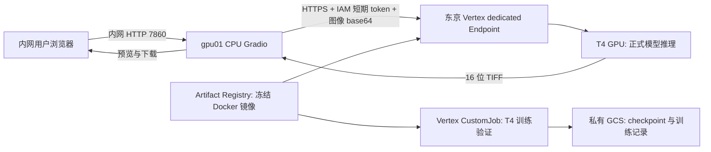

# Vertex AI 内网去噪系统部署、验收与操作说明

2026-11-18 源码整理：文中未提交／未推送的描述是验证当时的状态。源码与运维说明纳入 Git，原始运行记录保存在 NFS 的 `/mnt/home/huang/cst_ai/archive/basicsr-review-20261118/`；本次整理未重新部署或发起云端预测。

**用途：供上司检查部署结果，并交接给后续使用者和管理员。** 记录日期：2026-11-17。本文时间均为日本时间 JST（UTC+9）；原始 JSON 中保留 UTC。

## 1. 当前结论及验收边界

系统采用“内网 CPU Gradio 页面 + 东京 Vertex GPU 计算”的结构。内网用户访问页面，图像去噪在 Google Cloud 执行。本机没有运行去噪 GPU 模型。

| 检查项目 | 已完成的事实 | 范围与限制 |
|---|---|---|
| 内网页面 | `http://192.168.3.18:7860` 已启动，本文编写时 HTTP 200 | 运行在实验室 gpu01，服务器和网络需要保持可用 |
| 推理部署 | 东京 Vertex dedicated Endpoint，`n1-standard-8` + 单张 T4 | 使用既有缸盖 final step 30000 权重，只有一个默认模型 |
| 推理验收 | 64×64 PNG、1518×1518 16 位 TIFF 均成功返回同尺寸 16 位 TIFF | 验证了功能链路，不是重新进行模型精度评测 |
| 按需启停 | 副本 1→0、从 0 自动唤醒、再次 1→0 均有监控与请求证据 | Scale To Zero 为 Preview；低频使用会等待冷启动 |
| 训练验收 | Vertex 单 T4 完成 2 次真实 optimizer 更新，任务 `SUCCEEDED`，产物可下载并校验 | **完整 30,000 步训练尚未适配、尚未提交** |
| 实际消费 | 已使用真实云端 GPU、镜像仓库、对象存储和传输，属于可计费用量 | **本次未取得实际账单金额，不能报告为免费或已结算某个金额** |
| 镜像上传 | 两个 Docker 镜像已推送 Google Artifact Registry | 镜像包含运行代码；不等于源代码已推送 Git |
| 代码交接 | 本机代码与部署说明可检查 | **本轮部署改动尚未 git commit / push**，远端不是完整交接副本 |
| 管理入口 | 可使用 Google Cloud Console、Cloud Shell、gcloud、REST API | 不依赖 AI 助手才能管理；操作者仍需对应 IAM 权限 |

**最新状态补充：** 历史验收全部通过后，本次文档编写时只做了读取检查，没有再发起预测、训练或部署。最近的副本指标在 **21:07:14 为 0**，内网页面 HTTP 200；Endpoint 状态同时带有通用 `System error. Please try this operation again.` 消息，更新时间为 **21:07:53**。仅靠该消息无法判定原因，也不能据此保证当前再次唤醒成功。**“历史功能测试已通过”与“最新请求可用性已复验”应分开理解；后者本次没有重新验证。** 现场演示前应做一次实际预测，并在控制台核对结果。见本次只读复查记录（NFS：`/mnt/home/huang/cst_ai/archive/basicsr-review-20261118/docs/deploy/vertex-supervisor-review-20261117.json`）。

## 2. 实际资源清单

| 项目 | 实际值 |
|---|---|
| Google Cloud 项目 ID | `hallowed-pipe-497802-i0` |
| 项目编号 | `580558088344` |
| 区域 | `asia-northeast1`（东京） |
| 内网服务器 | gpu01，`192.168.3.18` |
| 内网入口 | [http://192.168.3.18:7860](http://192.168.3.18:7860) |
| 本机页面容器 | `denoise-vertex-ui` |
| Endpoint 名称 | `denoise-internal-v2-20261117` |
| Endpoint ID | `8911645097217490944` |
| Vertex Model ID | `6657078912276758528`，版本 1 |
| 当前 DeployedModel ID | `1239217774224474112`，重新部署后会改变 |
| 推理机器 | `n1-standard-8` + `NVIDIA_TESLA_T4` ×1 |
| 推理自动伸缩 | 最少 0、最多 1 副本；启动后最短保留 300 秒、无流量等待 300 秒 |
| 已完成的训练 CustomJob ID | `1044436952901746688` |
| 训练机器 | `n1-standard-8` + `NVIDIA_TESLA_T4` ×1，100 GB SSD 启动盘 |
| 训练服务账号 | `denoise-vertex@hallowed-pipe-497802-i0.iam.gserviceaccount.com` |
| Docker 仓库 | `asia-northeast1-docker.pkg.dev/hallowed-pipe-497802-i0/denoise` |
| 私有对象存储桶 | `gs://hallowed-pipe-497802-i0-denoise-vertex` |
| 训练测试产物前缀 | `gs://hallowed-pipe-497802-i0-denoise-vertex/vertex-smoke/20261117-run1/` |

最初尝试的 L4 因东京资源暂不可用失败，之后改用 T4。旧大镜像的 T4 部署也曾返回通用 code 13；精简推理镜像并新建 Endpoint 后部署成功。大镜像是否为该错误的唯一原因没有证据可以确认。旧失败 Endpoint `4295455479162732544` 已删除，旧 Model 注册记录可能仍能在控制台看到；当前使用的是上表的新资源。

本方案没有创建供用户登录的独立 Compute Engine VM、Cloud Run 网站或 Workbench。Vertex 管理的训练和预测机器应在 Vertex 对应页面检查，不应通过 Compute Engine 的 VM 列表判断它们是否存在。

## 3. 系统如何实现



### 3.1 推理数据流

1. 用户在 Gradio 上传 PNG/JPEG/TIFF 文件并按“Denoise”（2026-11-18 已恢复英文界面）。
2. 本机 `deploy/vertex/internal_ui.py` 读取文件，将其转换为 base64 JSON 请求。页面只负责文件、预览、请求和下载，没有加载本地模型。
3. 页面后台用现有用户 ADC 在内存中取得短期访问 token，经 HTTPS 调用受 IAM 保护的 Vertex API。浏览器不会得到该凭据。
4. Vertex 拉取推理镜像，启动 `serve.py`。FastAPI 提供 `/health` 和 `/predict`，模型启动时加载到 CUDA。
5. `serve.py` 调用项目已有的去噪 engine、模型注册及图像归一化逻辑。运行栈为 PyTorch **2.6.0+cu124**、CUDA **12.4**。
6. 云端返回 16 位 TIFF 的 base64、图像尺寸、模型名称、GPU 标记和处理耗时。页面生成预览并提供 TIFF 下载。

预览显示按预设归一化范围线性映射为 8 位图（2026-11-18 修正），下载文件保持 16 位 TIFF。当前页面一次只处理一个排队任务。接口总请求有 10 MB 限制，base64 会增加体积；不能把可上传的原始文件大小直接等同于 10 MB。1518×1518 的代表性 TIFF 已通过实测，更大图像未验收。

当前默认推理使用请求和响应内的 base64，不会主动把每次推理输入输出另存为 GCS 对象。文件会经过本机页面临时目录和云端容器临时目录；训练产物则明确保存到 GCS。页面的临时文件会按 Gradio 缓存配置清理，不应将下载链接作为永久归档。

### 3.2 按需启动、空闲释放

当前设置为 `minReplicaCount=0`、`maxReplicaCount=1`。没有流量时，Vertex 将模型服务副本降到 0；模型注册、Endpoint 配置、镜像和训练产物仍保留。

冷状态下首次请求会触发唤醒，Vertex 会先返回 429。页面已实现每 15 秒重试，最多 80 次重试，等待窗口约 20 分钟，另加各次网络请求时间。用户应保持页面等待，不必反复点击。

按官方说明，Scale To Zero 是 Preview，支持本方案的单机 GPU dedicated Endpoint；重新唤醒可能遇到库存不足。持续无流量、保持零副本超过 30 天时会自动 undeploy，需要重新部署。本文恢复步骤保留了这些配置。[官方说明](https://docs.cloud.google.com/vertex-ai/docs/predictions/autoscaling)

### 3.3 “内网”具体指什么

内网页面只绑定服务器的 `192.168.3.18:7860`，Gradio 设置 `share=False`，没有公开分享链接。Vertex API 使用**受 IAM 认证保护的 dedicated public HTTPS Endpoint**，并非通过 VPN/Private Service Connect 建立的纯私网 API。

当前页面没有单独的用户登录层。能访问该内网端口的人员可通过页面使用后台身份发起预测，费用计入同一个项目。用户个人无需登录 Google Cloud 才能使用页面；直接管理云资源的人则需要自己的 Google 账号和 IAM 权限。

## 4. 源代码、Docker 镜像、模型和训练数据存在哪里

**代码仓库与镜像仓库不是一个地方。** Docker 镜像相当于可运行的软件包，里面带有当时打包的代码、依赖和模型文件；Git 仓库用于审查修改、版本管理和协作。上传镜像不会自动提交 Git。

| 内容 | 位置 | 本轮状态 |
|---|---|---|
| 活跃源代码和部署文件 | `/mnt/home/huang/code/cst_ai/BasicSR` | 本机工作区，含未提交改动 |
| 项目 GitLab remote | [jil_atr/basicsr](https://gitlab.com/jil_atr/basicsr) | 配置存在；本轮没有推送部署改动 |
| 另有 GitHub remote | [huangpenguin/cst_ai_basicsr](https://github.com/huangpenguin/cst_ai_basicsr) | 配置存在；本轮同样没有推送 |
| Docker 训练镜像 | Artifact Registry 的 `denoise/denoise-vertex` | 已上传，含训练入口及 4 对验证样本 |
| Docker 推理镜像 | Artifact Registry 的 `denoise/denoise-vertex-inference` | 已上传，含正式 final 权重与推理程序 |
| Vertex Model Registry | Model `6657078912276758528` | 记录推理镜像 URI、端口与路由等部署信息 |
| 正式推理权重 | 推理 Docker 镜像内 `/opt/models/cylinderhead_final_i30000.pth` | 来自既有正式训练，不是两步测试生成的权重 |
| 新生成的训练测试权重和日志 | 上述私有 GCS `vertex-smoke/20261117-run1/` | 已上传并下载校验 |
| 完整训练数据 | 原本地数据目录 | 未整体上传 GCS，也不在推理镜像里 |

本机 Git HEAD 是 `41d7bfd32c33017182c6704fac952e75b5aad830`。**该 commit 并不包含当前工作区全部部署修改，不能仅凭它重建本次镜像。** 当前运行版本以镜像 digest 和验收记录为准。正式代码交接仍需审查并提交部署文件；仅从远端 clone 不能保证取得本文全部内容。

### 4.1 已上传镜像的确切版本

训练与本机页面使用的镜像：

```text
asia-northeast1-docker.pkg.dev/hallowed-pipe-497802-i0/denoise/denoise-vertex:20261117

asia-northeast1-docker.pkg.dev/hallowed-pipe-497802-i0/denoise/denoise-vertex@sha256:fac4b16b9454f8b4685743477959cff89175467d001d3407ecefcf2b4747a73f
```

Vertex 推理使用的镜像：

```text
asia-northeast1-docker.pkg.dev/hallowed-pipe-497802-i0/denoise/denoise-vertex-inference:20261117

asia-northeast1-docker.pkg.dev/hallowed-pipe-497802-i0/denoise/denoise-vertex-inference@sha256:d6a078989cb622fa40be6d5887908f6e0ec26b9ded22077aaf9b0688e7f231fc
```

| 镜像 | 本机 Docker 报告大小 | Artifact Registry API 报告大小 |
|---|---:|---:|
| 训练镜像 | 28,423,073,023 bytes，约 28.42 GB | 14,713,747,297 bytes，约 14.71 GB |
| 精简推理镜像 | 7,119,306,413 bytes，约 7.12 GB | 3,672,666,882 bytes，约 3.67 GB |

推理镜像本机报告大小减少约 **74.95%**。本机与仓库的大小口径不同，不能将两列混用；Registry 存储账单还涉及共享层及实际计费口径，不能把本机解压大小直接当成收费存储量。

构建关系为：`deploy/serve/Dockerfile` → `denoise-demo:local` 基础应用镜像 → `deploy/vertex/Dockerfile` → 已冻结训练镜像；`deploy/vertex/Dockerfile.inference` 从已验证镜像提取依赖、代码及权重，再使用同版 PyTorch 基础镜像构建较小的推理镜像。

**修改本机 `serve.py` 或模型代码不会自动改变云端容器。** 当前推理 Dockerfile 的部分代码从冻结源镜像复制，后续改动必须确认进入构建来源，再 build、push、注册新 Model 并部署。修改本机 `internal_ui.py` 后需重启页面进程；页面代码以只读 bind mount 使用。

## 5. 已经测试了什么，是否发生消费

### 5.1 真实推理与启停测试

| 测试 | 输入 | 结果 | 实测时间 |
|---|---|---|---|
| 热状态小图 | 64×64，8 位 PNG | 返回 64×64 uint16 TIFF | 云端 0.777 秒；提交至下载 6.809 秒 |
| 热状态代表图 | 1518×1518，16 位 TIFF | 返回同尺寸 uint16 TIFF | 云端 46.364 秒；提交至下载 61.912 秒 |
| 首次空闲释放 | 停止提交请求 | 同一模型副本由 1 降为 0 | 最后成功请求结束后 360.529 秒 |
| 休眠后唤醒 | 64×64，8 位 PNG | 页面自动重试并下载成功 | 云端 handler 1.635 秒；全流程 200.293 秒，约 3分20秒 |
| 唤醒后再次释放 | 不再提交请求 | 同一模型副本再次由 1 降为 0 | 冷请求完成后 366.712 秒；归零样本时间 20:28:14 |

200.293 秒包含唤醒、重试间隔、网络、推理与下载，**不是单纯 VM 开机时间**。未测“冷状态下 1518 整图”的总时间，不能直接将小图冷启动结果当作所有图像的处理时间保证。

页面测试客户端和页面服务器位于同一物理主机，通过上述内网 IP 完成完整链路。**尚未从另一台物理电脑验证跨主机网络访问**；同事第一次使用时应按第 6 节检查网络。

### 5.2 训练是否通过

**训练链路通过，完整正式训练尚未完成。** 这不是只检查 CUDA 是否可用，而是执行了真实训练、反向传播、优化器更新和产物上传。

| 检查项 | 结果 |
|---|---|
| CustomJob | `1044436952901746688`，`JOB_STATE_SUCCEEDED` |
| 数据 | 原训练 split 中 4 对真实 TIFF，不使用测试集训练 |
| GPU、batch、crop | T4 ×1，batch 1/GPU，128×128 crop |
| optimizer 更新 | 2 次 |
| 两次 loss | `1.8035e-05`、`5.6339e-05` |
| 任务创建 | 18:21:03 |
| 平台记录 start / end | 18:36:50 → 18:37:20 |
| 训练入口记录总耗时 | 21.296 秒，不能等同于整个资源占用或计费时间 |
| checkpoint | `245,750,558 bytes`，可在 CPU 上安全加载，544 个参数张量 |
| 参数变化检查 | `conv_first.weight` 相对初始预训练权重最大绝对变化约 `0.000199452` |
| GCS 产物 | 权重、训练日志、有效配置、summary 四项均下载并通过大小/MD5 校验 |

产物目录：

```text
gs://hallowed-pipe-497802-i0-denoise-vertex/vertex-smoke/20261117-run1/
  model/net_g_latest.pth
  training/train.log
  training/effective_train.json
  training/summary.json
```

两步测试完成后，训练 worker 已由 Vertex 释放，没有一直运行的训练 GPU。在线推理继续使用原正式 final 权重，没有用这份测试 checkpoint 替换。

### 5.3 实际费用的确认方式

**已产生可计费用量；确切金额本次未核实。** 最终实际扣款还取决于账单记录、折扣、赠金、税费等。不能因为只是测试、任务很短、部署失败或当前副本为零，就断言整轮测试没有费用。

| 消费来源 | 本轮是否发生资源使用 | 验收后状态 |
|---|---|---|
| Vertex Custom Training GPU/CPU/磁盘 | 是，真实 CustomJob | 任务已成功结束 |
| Vertex Online Prediction GPU/CPU | 是，部署、热状态推理、唤醒与空闲保留 | 已实测副本归零；本次较新的指标也为 0 |
| Artifact Registry 存储 | 是，两个镜像已上传 | 镜像仍保留，可能持续产生存储费用 |
| GCS 存储与操作 | 是，测试权重与记录已保存 | 产物仍保留；桶有 7 天 soft delete 策略 |
| 网络传输、日志等 | 本轮存在请求、传输和训练日志 | 按各服务实际账单及免费额度核算 |
| 部署失败尝试 | 有 L4 和旧镜像 T4 尝试 | 是否有已分配资源的收费，须由账单核对，不能只看失败状态 |

推理费用应按**活跃服务节点时间**核算，包含空闲等待缩容等时间，不能只乘 46.364 秒模型处理时间。训练费用也应按训练服务的资源与计费时段核算，不能把 21.296 秒当作全部计费时长。此前 Compute VM/L4 的约 US$1.6/小时方案不是当前 Vertex/T4 账单依据。

管理员在 [Cloud Billing](https://console.cloud.google.com/billing?project=hallowed-pipe-497802-i0) 打开 Reports，选择本项目、覆盖 2026-11-17 测试的时间范围，按 Service/SKU 分组，检查 Vertex、Artifact Registry、Cloud Storage 及相关网络/日志项目，再核对 credits/discounts。账单按其显示的报告时区核对，不要直接将本文 JST 日期窗口当作所有报表的时区。

官方提示费用入账通常在一天内，也可能超过 24 小时；当天暂未显示不代表没有用量。[账单延迟说明](https://docs.cloud.google.com/billing/docs/how-to/resolve-issues)

本次调用项目 `billingInfo` API 得到 403，原因是 `cloudbilling.googleapis.com` 未使用或未启用。**这不证明项目未绑定账单，也不证明网页 Billing 必然无法访问。** 本次没有为查金额启用新 API。查看本项目费用需要相应项目费用查看权限；查看整个账单账户则需要账户范围权限，例如 Billing Account Viewer。部署 IAM 与账单 IAM 是两套不同的检查范围。[Billing 报表及权限说明](https://docs.cloud.google.com/billing/docs/how-to/reports)

## 6. 之后如何从内网使用

1. 电脑接入能路由到 `192.168.3.18` 的公司/实验室网络。只连接某个公司 Wi-Fi 不一定代表能访问此网段；异地是否可用取决于已有 VPN 和路由，本轮没有部署 VPN。
2. 浏览器打开 [http://192.168.3.18:7860](http://192.168.3.18:7860)。不需要安装 Python、Docker、CUDA 或 Google SDK。
3. 上传 `.png`、`.jpg`、`.jpeg`、`.tif` 或 `.tiff`。首次建议用已验收尺寸的图像。
4. 点击一次“Denoise”，保持页面等待。闲置后第一次使用会经历云 GPU 唤醒；单次小图实测约 3分20秒，库存和启动情况可能使时间不同。
5. 查看输入/输出预览与状态文字，点击下载 16 位 TIFF。预览不作为原始灰度精度检查依据，应检查下载文件。
6. 使用结束无需点击云端关机。停止提交请求后，Vertex 按配置缩容；需要确定终止服务时由管理员 undeploy 模型。

如果网页打不开，在使用者电脑终端执行：

```bash
curl -I --connect-timeout 5 http://192.168.3.18:7860
```

无法连接时先检查内网路由、防火墙和服务器状态。网页能打开但处理失败时，再检查 Vertex、后台凭据及错误代码，两类故障不能混为一谈。

## 7. 本机页面如何启动、停止、恢复

本节在 **gpu01 的终端/SSH** 操作。Google Cloud 网页不会自动启动这台实验室服务器的 Docker 容器。

### 7.1 已有容器的日常操作

```bash
docker ps -a --filter name=denoise-vertex-ui
docker start denoise-vertex-ui       # 容器已存在但停止时
docker logs --tail 100 denoise-vertex-ui
curl -I http://192.168.3.18:7860
```

重启页面进程：

```bash
docker restart denoise-vertex-ui
```

停止页面：

```bash
docker stop denoise-vertex-ui
```

容器配置为 `--restart unless-stopped`，服务器和 Docker 恢复后通常会自动拉起此前运行中的容器；手动 stop 的容器应手动 start。服务器还必须具备内网 IP、可用的 NFS 代码挂载和凭据文件。

**停止页面只会阻止通过此页面发起请求，不会直接取消训练任务或撤销 Vertex 模型部署。** 云端各项资源需分别管理。

### 7.2 容器不存在时重新创建

先检查环境，确认 `/mnt/home` 确实是可读写 NFS，而不是未挂载的本地空目录：

```bash
findmnt -T /mnt/home
test -w /mnt/home/huang/code/cst_ai/BasicSR
test -r /home/huang/.config/pai_ai_control/gcloud/application_default_credentials.json
test -r /mnt/home/huang/code/cst_ai/BasicSR/deploy/vertex/internal_ui.py
docker image inspect denoise-vertex:local --format '{{.Id}}'
```

已验收本机镜像 ID 为：

```text
sha256:c5a18e2e2fdda2d1c0b4795c0aba58a11581d268edc4bcf4360853ccbb31efc4
```

确认没有同名容器后执行以下命令；容器存在时使用上一节的 start，不要重复 run：

```bash
VERTEX_PREDICT_URL='https://8911645097217490944.asia-northeast1-580558088344.prediction.vertexai.goog/v1/projects/580558088344/locations/asia-northeast1/endpoints/8911645097217490944:predict'

docker run -d --name denoise-vertex-ui \
  --restart unless-stopped \
  --user 1003:1003 \
  -e HOME=/tmp \
  -e NVIDIA_VISIBLE_DEVICES=void \
  -e CUDA_VISIBLE_DEVICES= \
  -e GOOGLE_APPLICATION_CREDENTIALS=/adc.json \
  -e VERTEX_PROJECT=hallowed-pipe-497802-i0 \
  -e VERTEX_PREDICT_URL="$VERTEX_PREDICT_URL" \
  -p 192.168.3.18:7860:7860 \
  --mount type=bind,src=/home/huang/.config/pai_ai_control/gcloud/application_default_credentials.json,dst=/adc.json,readonly \
  --mount type=bind,src=/mnt/home/huang/code/cst_ai/BasicSR/deploy/vertex/internal_ui.py,dst=/opt/internal_ui.py,readonly \
  denoise-vertex:local python /opt/internal_ui.py
```

该主机 Docker 默认 NVIDIA runtime，因此显式指定 `NVIDIA_VISIBLE_DEVICES=void`；仅省略 `--gpus` 不足以证明没有 GPU。已检查实际页面容器 `/dev/nvidia*` 为空。

原 ADC 属于 UID/GID `1003:1003`，权限为 `0600`，因此使用匹配 UID，只读挂载。不要把 ADC 放进 Docker 镜像、Git、浏览器或报告附件。当前页面依赖 `huang.pengbin@johnan.com` 的现有用户登录；该登录失效或权限撤销后，页面后台调用也会失败。

### 7.3 本机镜像缓存丢失时

镜像已在 Artifact Registry，不必依赖 AI 助手重建。在**已安装 gcloud 和 Docker 且已用有仓库读取权限的账号登录**的终端，可使用：

```bash
gcloud auth configure-docker asia-northeast1-docker.pkg.dev
docker pull asia-northeast1-docker.pkg.dev/hallowed-pipe-497802-i0/denoise/denoise-vertex@sha256:fac4b16b9454f8b4685743477959cff89175467d001d3407ecefcf2b4747a73f
docker tag asia-northeast1-docker.pkg.dev/hallowed-pipe-497802-i0/denoise/denoise-vertex@sha256:fac4b16b9454f8b4685743477959cff89175467d001d3407ecefcf2b4747a73f denoise-vertex:local
```

当前 gpu01 没有宿主 gcloud，之前使用 Cloud SDK 容器。该主机继续用 SDK 容器操作的方法见[技术 README](../../deploy/vertex/README.md)中的 `vertex_gcloud` 函数；不要把上述“gcloud 已安装”的命令当作 gpu01 现在已满足的条件。如果换机器，还需转移获准使用的源文件、重新建立其合法身份配置，并调整内网绑定 IP 与 UID。

## 8. 上司能在哪里用网页检查、管理

**可以使用 Google Cloud Console，管理不需要经过本助手。** `gcloud` 是命令行工具；带 UI 的网站叫 **Google Cloud Console**。可在 Console 右上角打开 **Cloud Shell**，在浏览器中执行命令，不必在上司的电脑安装 gcloud。

先登录具有本项目权限的公司账号，并确认项目为 `hallowed-pipe-497802-i0`，Vertex 区域为 `asia-northeast1`。菜单名称可能随控制台语言或产品更新变化，以下链接以入口和资源 ID 为核对依据。

| 要检查的内容 | 网页入口 | 应检查的对象/内容 |
|---|---|---|
| 推理部署 | [Vertex Online prediction / Endpoints](https://console.cloud.google.com/vertex-ai/endpoints?project=hallowed-pipe-497802-i0) | 东京，Endpoint `8911645097217490944`；模型、机器规格、流量分配、状态；可执行 Undeploy |
| 模型注册信息 | [Vertex Model Registry](https://console.cloud.google.com/vertex-ai/models?project=hallowed-pipe-497802-i0) | Model `6657078912276758528`，容器镜像与版本 |
| 训练任务 | [Vertex Training / Custom jobs](https://console.cloud.google.com/vertex-ai/training/custom-jobs?project=hallowed-pipe-497802-i0) | 任务 `1044436952901746688`，状态 SUCCEEDED、资源规格、起止时间和日志入口 |
| Docker 镜像 | [Artifact Registry / denoise](https://console.cloud.google.com/artifacts/docker/hallowed-pipe-497802-i0/asia-northeast1/denoise?project=hallowed-pipe-497802-i0) | `denoise-vertex`、`denoise-vertex-inference`，标签及 digest |
| 权重与日志文件 | [Cloud Storage bucket](https://console.cloud.google.com/storage/browser/hallowed-pipe-497802-i0-denoise-vertex?project=hallowed-pipe-497802-i0) | `vertex-smoke/20261117-run1/` 中四项训练产物，可下载 |
| GPU 副本数 | [Cloud Monitoring / Metrics Explorer](https://console.cloud.google.com/monitoring/metrics-explorer?project=hallowed-pipe-497802-i0) | 过滤本 Endpoint 和 DeployedModel，查看副本曲线 |
| 云端日志 | [Logs Explorer](https://console.cloud.google.com/logs/query?project=hallowed-pipe-497802-i0) | 训练任务实际日志；当前推理容器 stdout/stderr 日志未启用 |
| 实际费用 | [Cloud Billing](https://console.cloud.google.com/billing?project=hallowed-pipe-497802-i0) | Reports 中按本项目、日期和服务/SKU 过滤，需要账单查看权限 |
| 身份与权限 | [IAM](https://console.cloud.google.com/iam-admin/iam?project=hallowed-pipe-497802-i0) | 查看授权；有查看权限不代表有修改 IAM 的权限 |

推理撤销部署可在 Endpoint 内找到模型行的操作菜单，选择 **Undeploy model from endpoint**；等待完成后，模型不再保留服务资源。恢复服务则需重新 deploy，并按第 9 节保留 scale-to-zero 配置。[官方操作说明](https://docs.cloud.google.com/vertex-ai/docs/predictions/undeploy-model)

在 Metrics Explorer 使用以下完整过滤条件，不能只看整个项目所有 GPU 的总数：

```text
metric.type="aiplatform.googleapis.com/prediction/online/replicas"
AND resource.type="aiplatform.googleapis.com/Endpoint"
AND resource.labels.location="asia-northeast1"
AND resource.labels.endpoint_id="8911645097217490944"
AND metric.labels.deployed_model_id="1239217774224474112"
```

该指标按分钟采样并有上报延迟。空白图、查错区域、旧模型的零点都不能证明当前模型已经归零。重新部署后应替换过滤器中的 DeployedModel ID。

训练日志可在 Logs Explorer 查询：

```text
resource.type="ml_job"
resource.labels.job_id="1044436952901746688"
```

查看测试日历史日志时需将时间范围切到 2026-11-17 对应时段。推理当前 `disableContainerLogging=true`，不能保证在 Logs Explorer 看到预测容器 stdout/stderr；HTTP 返回、Endpoint 状态和副本指标与训练日志是不同证据。

### 8.1 是否有“训练启动 UI”

有 Google 管理界面，但**当前 Gradio 只提供推理，没有训练按钮或自建训练管理网页**。已有 CustomJob 可在 Google Cloud 中查看；结束的训练任务不会因为打开页面而重新运行。

官方 Console 的创建训练向导是创建 TrainingPipeline，再由它创建 CustomJob，并非直接复制一个裸 CustomJob。可以通过该向导选择自定义容器、GPU、命令参数、服务账号和输出位置；若要严格复现本次成功请求，使用下面的 Cloud Shell 配置更明确。[官方 CustomJob 创建说明](https://docs.cloud.google.com/vertex-ai/docs/training/create-custom-job)

## 9. 不经过 AI 助手的云端操作步骤

以下命令在 **Google Cloud Console → Cloud Shell** 执行，使用当前网页登录账号权限。只读检查不会启动训练或主动唤醒模型；明确标为“会创建资源”的命令会发生新的云资源使用。本文编写期间只执行读取，没有执行下面的恢复、撤销或复跑命令。

### 9.1 只读检查

```bash
gcloud config set project hallowed-pipe-497802-i0
gcloud auth list --filter=status:ACTIVE

gcloud ai endpoints describe 8911645097217490944 \
  --project=hallowed-pipe-497802-i0 \
  --region=asia-northeast1 --format=json

gcloud ai custom-jobs describe 1044436952901746688 \
  --project=hallowed-pipe-497802-i0 \
  --region=asia-northeast1 --format=json

gcloud artifacts docker images list \
  asia-northeast1-docker.pkg.dev/hallowed-pipe-497802-i0/denoise \
  --include-tags

gcloud storage ls --recursive \
  gs://hallowed-pipe-497802-i0-denoise-vertex/vertex-smoke/20261117-run1/
```

REST 的零值标量可能不出现在返回 JSON 中。比如配置为 0 的最小副本字段、当前为 0 的可用副本字段可能被省略；“字段不存在”不应直接解释为“没配置”或“副本是 1”。scale-to-zero 的精确配置见成功请求及 v1beta1 返回，实际运行副本看 Monitoring。

### 9.2 暂时停止与确定撤销部署的区别

| 操作 | 效果 | 恢复方式 |
|---|---|---|
| 不再发送请求 | 由 Vertex 自动缩至 0，保留模型部署 | 下一次预测触发自动唤醒，页面重试 |
| `docker stop denoise-vertex-ui` | 停止内网页面；云端并不直接撤销 | 本机 `docker start`；云端缩容单独确认 |
| Endpoint **Undeploy** | 撤销模型服务部署，释放其资源 | 必须重新部署；发送预测本身不能恢复 |
| CustomJob **Cancel** | 请求停止仍在运行的训练任务 | 重新创建新任务，恢复能力取决于已持久化状态 |

确定暂时不再提供推理时，可在 Console Undeploy，或使用当前实际 DeployedModel ID：

```bash
gcloud ai endpoints undeploy-model 8911645097217490944 \
  --project=hallowed-pipe-497802-i0 \
  --region=asia-northeast1 \
  --deployed-model-id=1239217774224474112
```

先通过 describe 确认该 ID 仍是目标部署。命令完成后再次检查 Endpoint 和指标。Undeploy 不会删除镜像和训练产物，所以不是把所有存储费用一起清零。当前训练测试已成功结束，不需要 cancel 或删除训练历史。

### 9.3 Undeploy 后重新启动云端推理

**仅在 Endpoint 已无模型部署时执行。会重新分配 GPU 并产生新的可计费用量。** 普通的零副本休眠无需执行此命令，直接从页面请求即可。

以下 REST v1beta1 配置与成功部署使用的资源配置一致，避免在 UI 操作时意外恢复成最少 1 副本常驻：

```bash
cat > /tmp/denoise-deploy-model.json <<'JSON'
{
  "deployedModel": {
    "model": "projects/580558088344/locations/asia-northeast1/models/6657078912276758528",
    "displayName": "denoise-final-t4-lean",
    "dedicatedResources": {
      "machineSpec": {
        "machineType": "n1-standard-8",
        "acceleratorType": "NVIDIA_TESLA_T4",
        "acceleratorCount": 1
      },
      "minReplicaCount": 0,
      "maxReplicaCount": 1,
      "initialReplicaCount": 1,
      "scaleToZeroSpec": {
        "minScaleupPeriod": "300s",
        "idleScaledownPeriod": "300s"
      }
    }
  },
  "trafficSplit": {"0": 100}
}
JSON

curl --fail-with-body -sS -X POST \
  -H "Authorization: Bearer $(gcloud auth print-access-token)" \
  -H 'x-goog-user-project: hallowed-pipe-497802-i0' \
  -H 'Content-Type: application/json' \
  --data-binary @/tmp/denoise-deploy-model.json \
  'https://asia-northeast1-aiplatform.googleapis.com/v1beta1/projects/580558088344/locations/asia-northeast1/endpoints/8911645097217490944:deployModel' \
  > /tmp/denoise-deploy-operation.json

cat /tmp/denoise-deploy-operation.json
```

返回的是长时间操作，不是立即就绪。记录返回的 `name`，查询其最终结果：

```bash
OPERATION_NAME="$(python3 -c 'import json; print(json.load(open("/tmp/denoise-deploy-operation.json"))["name"])')"

curl --fail-with-body -sS \
  -H "Authorization: Bearer $(gcloud auth print-access-token)" \
  -H 'x-goog-user-project: hallowed-pipe-497802-i0' \
  "https://asia-northeast1-aiplatform.googleapis.com/v1beta1/${OPERATION_NAME}"
```

应等待 `done: true` 且无 `error`，然后 describe Endpoint，记录新的 DeployedModel ID 和流量分配，再从内网页面做一次预测。本次首次成功部署请求至就绪约 **19分50秒**，不是前述休眠唤醒的 3分20秒，两者不同。

只要 Endpoint 未删除，专属预测地址通常继续取自同一 Endpoint 配置；如果重建了 Endpoint，必须读取新地址并更新页面环境变量，再创建对应页面容器。不能把管理 API URL 当作预测 URL。

### 9.4 复跑已验证的两步训练

**本节启动新的付费训练任务，不是完整 30,000 步训练。** 即使已有成功任务，也要 create 新任务，而不是尝试“启动”已结束的旧任务。

在 Cloud Shell 生成独立输出目录和配置：

```bash
RUN_ID="$(date -u +%Y%m%dT%H%M%SZ)"
export RUN_ID

python3 - <<'PY'
import json, os
run_id = os.environ['RUN_ID']
output = 'gs://hallowed-pipe-497802-i0-denoise-vertex/vertex-smoke/' + run_id
spec = {
    'serviceAccount': 'denoise-vertex@hallowed-pipe-497802-i0.iam.gserviceaccount.com',
    'baseOutputDirectory': {'outputUriPrefix': output},
    'workerPoolSpecs': [{
        'machineSpec': {
            'machineType': 'n1-standard-8',
            'acceleratorType': 'NVIDIA_TESLA_T4',
            'acceleratorCount': 1,
        },
        'replicaCount': '1',
        'diskSpec': {'bootDiskType': 'pd-ssd', 'bootDiskSizeGb': 100},
        'containerSpec': {
            'imageUri': 'asia-northeast1-docker.pkg.dev/hallowed-pipe-497802-i0/denoise/denoise-vertex@sha256:fac4b16b9454f8b4685743477959cff89175467d001d3407ecefcf2b4747a73f',
            'args': ['python', '/opt/vertex/train_smoke.py', '--iterations', '2', '--output-uri', output],
        },
    }],
    'scheduling': {'timeout': '1800s', 'disableRetries': True, 'restartJobOnWorkerRestart': False},
}
with open('/tmp/denoise-customjob.json', 'w') as f:
    json.dump(spec, f, indent=2)
print(output)
PY

TRAINING_JOB="$(gcloud ai custom-jobs create \
  --project=hallowed-pipe-497802-i0 \
  --billing-project=hallowed-pipe-497802-i0 \
  --region=asia-northeast1 \
  --display-name="denoise-smoke-${RUN_ID}" \
  --config=/tmp/denoise-customjob.json \
  --format='value(name)')"

printf '%s\n' "$TRAINING_JOB"

gcloud ai custom-jobs describe "${TRAINING_JOB##*/}" \
  --project=hallowed-pipe-497802-i0 \
  --region=asia-northeast1
```

配置根节点是 `CustomJobSpec`，不要再包一层 `jobSpec`。后续在网页或 describe 中确认 `JOB_STATE_SUCCEEDED`，检查本次 RUN_ID 对应四项产物。任务资源等待、镜像准备与程序执行是不同阶段，等待不等于没有启动成功。

若任务仍在运行且需要终止：

```bash
gcloud ai custom-jobs cancel "${TRAINING_JOB##*/}" \
  --project=hallowed-pipe-497802-i0 \
  --region=asia-northeast1
```

取消后仍需查看终态。任务 ID 变量仅在创建时的 shell 中存在，换终端后应从任务记录填入真实 ID。

### 9.5 这套权限实际做到了什么

本次实际成功创建训练服务账号和私有桶、设置桶对象权限、向现有 Artifact Registry 推送镜像、注册模型、部署 Endpoint、调用预测、提交并完成训练。曾因 Vertex Custom Code Service Agent 缺少镜像读取权限而被训练预检拒绝，已在 **denoise 仓库范围**补充其 `roles/artifactregistry.reader`，随后真实训练成功。

训练服务账号对输出桶有 `roles/storage.objectUser`，训练运行需要操作者具有该服务账号的 `actAs` 权限。当前默认 base64 推理没有另配自定义预测服务账号。项目/服务账号 IAM 修改、账单查看、删除所有镜像、增加 GPU 配额等不应由“部署成功”推导为全部已获授权。

其他管理员以自己的账号操作时，也需具有相应权限；不需要复制 Huang 的 ADC，也不需要 AI 助手代为持有凭据。Console 按钮不可用或 403 时，先核对登录账号、项目、区域和具体权限，保留错误信息再申请所缺权限。

## 10. 完整训练还有哪些准备没有完成

| 项目 | 原正式训练/数据规模 | 当前 Vertex 验证状态 |
|---|---|---|
| 训练 GPU | 4×V100 32 GB | 仅验证单 T4 |
| batch | 每 GPU 4，全局 16 | 每 GPU 1，全局 1，不等价 |
| crop | 128×128 | 相同 |
| 每卡历史显存 | 约 25,527 MiB | 不能据此认为 16 GB T4 可直接承载原 batch |
| 迭代数 | 30,000 | 只做 2 次，现入口限制 1–8 次 |
| 数据 | 训练 6,090 对，监控验证 20 对；测试 2,020 对另行隔离 | 镜像内仅 4 对训练样本 |
| 训练+监控验证文件 | 6,110 对、12,220 个 TIFF | 未完整上传 GCS |
| 数据大小 | 逻辑合计 52.452 GiB；原硬链接去重占用 28.849 GiB | 普通上传或展开不一定保留硬链接去重 |
| 调度与验证 | 学习率节点 15,000/25,000；每 2,000 步验证、每 1,000 步保存 | smoke 移除了这些长训练设置 |
| 恢复与持久化 | 需要 checkpoint、optimizer/scheduler state、验证结果和日志持续保存 | 目前在结束后上传 latest/日志/summary，未实现完整周期持久化与恢复 |

正式训练需要适配完整数据的私有 GCS 路径、原 split、归一化和训练配置，确定 GPU/batch 或 DDP 方案，重新核算磁盘及 timeout，并实现周期产物上传与断点恢复。现有模型每 batch 直接 optimizer step，不能仅写一个梯度累积参数就声称等价于原配置。

源配置是 `scripts/workflows/cylinderhead_20261104/config/train.yml`。**只把两步脚本参数改成 30000 不可用**，也不能以本次两步训练的耗时线性外推出可信的正式训练总费用。完成上述适配并做代表性测速后，才可核定完整训练的配置、时长与预算。

## 11. 使用中出现问题时如何检查

| 现象 | 首先检查 | 对应处理 |
|---|---|---|
| 页面无法连接 | gpu01、Docker、7860 端口、客户端到内网 IP 的路由 | 本机 start/logs；网络由内网管理员核对 |
| 上传后提示超过 10 MB | base64 JSON 的整体体积 | 使用更小的输入；大图传输方式需另做适配和验收 |
| 提示等待 GPU / 429 | 副本是否为 0、是否正在唤醒、库存/配额、最新状态消息 | 等待页面重试；超时后查 Endpoint，不反复手动提交 |
| 401 / 凭据刷新失败 | 后台用户 ADC 是否仍有效 | 由该身份持有人恢复合法登录，再重启页面；不分发原凭据 |
| 403 | 当前身份与错误中具体缺失权限 | 区分服务使用、预测、镜像、桶、actAs、账单权限 |
| 云端 5xx / System error | 当前 Endpoint 状态、部署操作错误、可用副本与时间范围 | 保留具体响应；需要时由管理员重新部署或联系 Google 支持，不将历史成功当作当前可用性证据 |
| 很久未用后无法自动恢复 | Endpoint 是否已因 30 天零流量自动 undeploy | 确认无部署后按第 9.3 节重新 deploy |
| 训练任务失败/无产物 | job 状态、`ml_job` 日志、镜像读取、服务账号桶权限 | 当前入口在训练结束后上传；失败前的持久化能力有限 |
| 看不到本次改动 | 查看的是 Git 远端还是本机工作区 | 本轮未 push，应先检查本文标出的本机路径和冻结镜像 |

## 12. 审查证据与源文件索引

| 证据 | 文件 |
|---|---|
| 总部署记录 | vertex-deployment-20261117.json（NFS：`/mnt/home/huang/cst_ai/archive/basicsr-review-20261118/docs/deploy/vertex-deployment-20261117.json`） |
| 成功的推理部署请求、操作结果和资源配置 | vertex-inference-v2-20261117.json（NFS：`/mnt/home/huang/cst_ai/archive/basicsr-review-20261118/docs/deploy/vertex-inference-v2-20261117.json`） |
| 页面到云 GPU 再到下载的测试 | vertex-ui-live-20261117.json（NFS：`/mnt/home/huang/cst_ai/archive/basicsr-review-20261118/docs/deploy/vertex-ui-live-20261117.json`） |
| 页面容器不带 GPU、端口和 HTTP 检查 | vertex-ui-runtime-20261117.json（NFS：`/mnt/home/huang/cst_ai/archive/basicsr-review-20261118/docs/deploy/vertex-ui-runtime-20261117.json`） |
| 首次空闲归零 | vertex-idle-20261117.json（NFS：`/mnt/home/huang/cst_ai/archive/basicsr-review-20261118/docs/deploy/vertex-idle-20261117.json`） |
| 真实冷启动请求 | vertex-cold-start-20261117.json（NFS：`/mnt/home/huang/cst_ai/archive/basicsr-review-20261118/docs/deploy/vertex-cold-start-20261117.json`） |
| 冷请求后再次归零 | vertex-idle-after-cold-20261117.json（NFS：`/mnt/home/huang/cst_ai/archive/basicsr-review-20261118/docs/deploy/vertex-idle-after-cold-20261117.json`） |
| 真实训练、loss、产物校验与正式训练差距 | vertex-training-20261117.json（NFS：`/mnt/home/huang/cst_ai/archive/basicsr-review-20261118/docs/deploy/vertex-training-20261117.json`） |
| 文档编写时的只读状态、Registry 大小及 Billing API 响应 | vertex-supervisor-review-20261117.json（NFS：`/mnt/home/huang/cst_ai/archive/basicsr-review-20261118/docs/deploy/vertex-supervisor-review-20261117.json`） |
| 技术说明与 gpu01 的 SDK 容器操作方式 | [deploy/vertex/README.md](../../deploy/vertex/README.md) |
| 本机页面实现 | [internal_ui.py](../../deploy/vertex/internal_ui.py) |
| Vertex 预测协议实现 | [serve.py](../../deploy/vertex/serve.py) |
| 训练验证入口与复跑配置 | [train_smoke.py](../../deploy/vertex/train_smoke.py)、[custom-job.smoke.json](../../deploy/vertex/custom-job.smoke.json) |
| 推理镜像构建与预设 | [Dockerfile.inference](../../deploy/vertex/Dockerfile.inference)、[models.inference.yaml](../../deploy/vertex/models.inference.yaml) |

文中“已通过”依据实际执行记录；启动/复跑/恢复命令用于交接，不表示文档编写期间又运行了一遍。当前需要由负责人继续确认的项目是：最新平台系统错误后的实际预测可用性、跨物理电脑的内网访问、账单实际金额、代码提交交接，以及完整正式训练适配。
